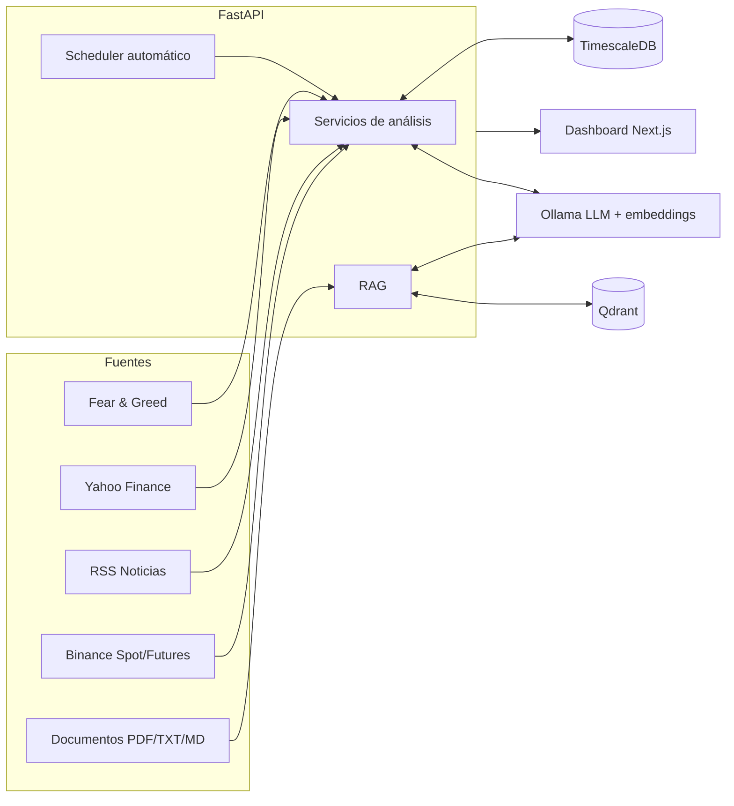

<div align="center">

# 🧠 BTC Intelligence AI

**Plataforma local de inteligencia y análisis de trading para BTC/USDT**
Datos reales · IA local (Ollama) · RAG sobre tu propia biblioteca · Sin enviar nada a la nube


</div>

> ⚠️ **Aviso importante:** esta plataforma es una herramienta de **análisis y evaluación de riesgo**.
> No garantiza resultados ni genera señales validadas estadísticamente. La similitud histórica y las
> anomalías son heurísticas explicables, no predicciones. Por defecto **no ejecuta operaciones reales**.

---

## 📌 Índice

- [¿Qué es?](#-qué-es)
- [Características](#-características)
- [Arquitectura](#-arquitectura)
- [Inicio rápido](#-inicio-rápido)
- [Configuración de modelos de IA](#-configuración-de-modelos-de-ia)
- [Uso del dashboard](#-uso-del-dashboard)
- [API](#-api)
- [Backtesting y Paper Trading](#-backtesting-paper-trading-y-journal)
- [Conexión opcional a Binance Futures](#-conexión-opcional-a-binance-futures)
- [Principios de la IA](#-principios-de-la-ia)
- [Estructura del proyecto](#-estructura-del-proyecto)
- [Roadmap](#-roadmap)

---

## 🎯 ¿Qué es?

BTC Intelligence AI reúne en un solo dashboard **mercado, estructura, derivados, noticias, macro,
sentimiento y conocimiento propio**, y se los entrega a un LLM local para generar un **AI Market Bias**
con evidencia, nivel de confianza y condiciones de invalidación.

Todo corre en tu máquina con Docker. El modelo **solo ve datos reales** que el sistema le inyecta;
cuando faltan datos responde "datos insuficientes" en lugar de inventar.

## ✨ Características

| Módulo | Qué hace |
|---|---|
| 📈 **Market Data & Técnico** | Velas reales de Binance (`ccxt`), EMA, SMA, RSI, MACD, ATR, Bollinger, VWAP, soportes/resistencias y régimen de mercado. |
| 🏗️ **Market Structure** | Swing highs/lows, tendencia estructural y eventos **BOS / CHOCH** marcados en el gráfico. |
| ⏱️ **Multi-Timeframe** | Análisis simultáneo 5m / 15m / 1h / 4h / 1d con consenso ("X/Y timeframes bullish"). |
| 🧮 **Derivados** | Open Interest, Funding Rate, Long/Short Ratio y Basis, con detección de anomalías (squeezes, funding extremo, spikes de OI). |
| 📰 **News Intelligence** | RSS de CoinDesk, Cointelegraph y Decrypt, filtrado BTC y clasificación bullish/bearish/neutral con heurística transparente. Análisis de impacto por noticia con IA. |
| 🌍 **Macro Dashboard** | DXY, S&P 500, NASDAQ, VIX, US10Y y Gold (`yfinance`) → entorno **RISK-ON / NEUTRAL / RISK-OFF**. |
| 😨 **Sentimiento** | Fear & Greed Index real + distribución de sentimiento de noticias → veredicto global. |
| 📚 **Knowledge Center + RAG** | Sube PDF/TXT/MD, se indexan localmente en Qdrant y la IA responde **citando sus fuentes**. |
| 🕰️ **Historical Similarity** | Encuentra los momentos históricos más parecidos al setup actual y muestra qué pasó después. |
| 🚨 **Anomaly Detector** | Z-scores de precio y volumen + **alertas combinadas** cruzadas con derivados. |
| 🧪 **Fase 7 Lab** | Backtesting, paper trading, trade journal y autopsias de operaciones. |
| 🔗 **Binance Futures (opcional)** | Balance, posiciones y órdenes protegidas, con Testnet por defecto. |

<details>
<summary><b>Ver detalle por fase</b></summary>

- **Fase 1:** Market data + TimescaleDB + análisis técnico + gráfico + Ollama + dashboard.
- **Fase 2:** Multi-timeframe, Market Structure (BOS/CHOCH) y dashboard de derivados.
- **Fase 3:** News, Macro y Sentimiento. Incluye un manejador global de excepciones en `main.py`
  para que los errores 500 siempre lleven cabeceras CORS y el detalle real (antes el navegador
  solo mostraba *"CORS Missing Allow Origin"*).
- **Fase 4:** Knowledge Center y RAG con embeddings locales (`nomic-embed-text`).
- **Fase 5:** Historical Similarity Engine y Anomaly Detector.
- **Fase 7:** Backtesting, Paper Trading, Journal y Autopsy.

</details>

## 🏛️ Arquitectura



**Sincronización automática:** mercado cada 60 s · derivados y anomalías cada 5 min ·
noticias cada 10 min · macro y sentimiento cada 15 min.

## 🚀 Inicio rápido

### Requisitos

- Docker y Docker Compose
- ~8 GB de RAM libres (para modelos como `llama3.1:8b`)
- Conexión a internet (velas de Binance y descarga de modelos)

### 1. Levantar el entorno

```bash
cd btc-intelligence-ai
cp backend/.env.example backend/.env   # revisa y ajusta si lo necesitas
docker compose up --build
```

| Servicio | Puerto | Descripción |
|---|---|---|
| `timescaledb` | 5433 | Base de datos (5432 dentro de Docker) |
| `qdrant` | 6333 | Vector DB para RAG |
| `ollama` | 11434 | LLM local |
| `backend` | 8000 | API FastAPI |
| `frontend` | 3000 | Dashboard Next.js |

### 2. Descargar los modelos (una sola vez)

```bash
docker exec -it btc_ollama ollama pull llama3.1
docker exec -it btc_ollama ollama pull gemma2:2b
docker exec -it btc_ollama ollama pull nomic-embed-text   # necesario para el Knowledge Center / RAG
```

### 3. Cargar datos de mercado

El backend sincroniza solo cada 60 s, pero para la primera carga con más historial:

```bash
curl -X POST "http://localhost:8000/market/sync?symbol=BTC/USDT&limit=500"
```

…o pulsa **🔄 Sync Market Data** en el dashboard. También existe `POST /sync/all`, que sincroniza
todo de una vez y reporta `failed_steps` si alguna fuente falla (las demás continúan).

### 4. Abrir la app

| | URL |
|---|---|
| Dashboard | http://localhost:3000 |
| Documentación interactiva de la API | http://localhost:8000/docs |

## 🤖 Configuración de modelos de IA

Dos modelos con responsabilidades distintas:

| Variable | Modelo por defecto | Uso |
|---|---|---|
| `OLLAMA_MODEL` | `llama3.1` | Binance AI Analyst, RAG, análisis técnico, propuestas y riesgo |
| `OLLAMA_CHAT_MODEL` | `gemma2:2b` | Conversación casual y saludos rápidos |
| `OLLAMA_EMBED_MODEL` | `nomic-embed-text` | Embeddings locales para RAG |

Si cambias de modelo, actualiza `backend/.env` y recrea el backend.
> 💡 No cambies `OLLAMA_MODEL` a Gemma si quieres conservar la calidad del análisis financiero.

## 🖥️ Uso del dashboard

- **Gráfico de velas** con soportes, resistencias y marcadores BOS/CHOCH.
- **Market Overview:** precio, cambio 24h, volatilidad, régimen y **AI Market Bias** con confianza y explicación.
- **Tarjetas** de Multi-Timeframe, Derivados, Noticias, Macro, Sentimiento y Knowledge Center.
- **Pestaña "Memoria & Alertas":** similitud histórica y anomalías combinadas.
- **Pestaña "Fase 7 Lab":** backtests, paper trading y journal.
- **Chat con PanCrasito:** pregunta en lenguaje natural, por ejemplo *"¿Existe una oportunidad LONG ahora?"*.
  Activa **«Usar conocimiento de `knowledge_library/`»** para que la respuesta combine el contexto
  técnico actual con fragmentos de tu biblioteca y cite sus fuentes.

### Cómo funciona la biblioteca (RAG)

1. Sincroniza `knowledge_library/` desde el Knowledge Center y espera a que los documentos pasen a `ready`.
2. Cada documento se trocea en chunks con solapamiento, se embebe con Ollama y se indexa en Qdrant.
3. Al preguntar, se recuperan solo los `top_k` fragmentos más similares: **no se reentrena el modelo
   ni se envían libros completos al contexto**.
4. Si no hay fragmentos suficientes, la IA lo dice explícitamente. Un PDF escaneado sin texto
   extraíble queda en `error`; nunca se inventa contenido.

## 🔌 API

Documentación completa e interactiva en **http://localhost:8000/docs**. Resumen por módulo:

<details>
<summary><b>Mercado, técnico y estructura</b></summary>

| Método | Endpoint | Descripción |
|---|---|---|
| POST | `/market/sync` | Descarga y guarda velas reales |
| POST | `/sync/all` | Sincroniza mercado, derivados, noticias, macro, sentimiento, biblioteca, anomalías y oportunidades |
| GET | `/market/candles` | Velas OHLCV guardadas |
| GET | `/market/indicators` | Indicadores técnicos |
| GET | `/market/levels` | Soportes y resistencias |
| GET | `/market/overview` | Resumen completo + AI Market Bias |
| GET | `/market/structure` | Swings, tendencia y eventos BOS/CHOCH |
| GET | `/market/multi-timeframe` | Consenso 5m/15m/1h/4h/1d |
| POST | `/ai/ask` | Pregunta libre a la IA (`use_knowledge: true` para activar RAG) |

</details>

<details>
<summary><b>Derivados</b></summary>

| Método | Endpoint | Descripción |
|---|---|---|
| POST | `/derivatives/sync` | Descarga OI, funding y L/S ratio y detecta anomalías |
| GET | `/derivatives/latest` | Último snapshot |
| GET | `/derivatives/history` | Histórico para graficar |

> Requiere que el símbolo tenga perpetuos en Binance (BTC/USDT los tiene).

</details>

<details>
<summary><b>Noticias, Macro y Sentimiento</b></summary>

| Método | Endpoint | Descripción |
|---|---|---|
| POST | `/news/sync` | Descarga noticias de los feeds RSS |
| GET | `/news/latest` | Últimas noticias con su clasificación |
| GET | `/news/sentiment-breakdown` | % bullish/bearish/neutral |
| POST | `/news/analyze/{news_id}` | "Analyze impact on BTC" de una noticia |
| POST | `/macro/sync` | Descarga datos macro |
| GET | `/macro/latest` | Snapshot + RISK-ON/NEUTRAL/RISK-OFF |
| GET | `/macro/history?indicator=DXY` | Histórico (DXY, SPX, NDX, VIX, US10Y, GOLD) |
| POST | `/sentiment/sync` | Refresca Fear & Greed + noticias |
| GET | `/sentiment/latest` | Último sentimiento combinado |
| GET | `/sentiment/history` | Histórico de sentimiento |

> No requieren API keys (Yahoo Finance y alternative.me son públicas).
> Reddit, X y Google Trends están documentados como fuentes pendientes y **no se simulan**.

</details>

<details>
<summary><b>Knowledge Center (RAG)</b></summary>

| Método | Endpoint | Descripción |
|---|---|---|
| POST | `/knowledge/upload` | Sube un documento (`file`, `category`, `title` opcional); indexa en background |
| GET | `/knowledge/documents` | Lista documentos y estado (`processing` / `ready` / `error`) |
| DELETE | `/knowledge/documents/{id}` | Elimina documento, chunks y vectores |
| POST | `/knowledge/ask` | `{ "question": "...", "category": null, "top_k": 5 }` → respuesta + fuentes con score |

Categorías: Technical Analysis, Price Action, Psychology, Risk Management, Crypto,
Quantitative Trading, Behavioral Finance, entre otras.

</details>

<details>
<summary><b>Similitud histórica y anomalías</b></summary>

| Método | Endpoint | Descripción |
|---|---|---|
| GET | `/historical/similar?symbol=BTC/USDT&timeframe=1h&lookback_window=20&forward_window=10&top_k=5` | Setups históricos más parecidos y qué ocurrió después |
| GET | `/historical/history?symbol=BTC/USDT` | Consultas resueltas (auditoría) |
| POST | `/anomalies/scan?symbol=BTC/USDT&timeframe=5m` | Detecta anomalías y arma alertas combinadas |
| GET | `/anomalies/latest?symbol=BTC/USDT` | Últimas señales persistidas |

- Si no hay suficiente historial, `/historical/similar` responde `"status": "insufficient_data"`.
- El detector necesita ~55 velas del timeframe rápido; sin ellas, no reporta anomalías (no inventa umbrales).

</details>

## 🧪 Backtesting, Paper Trading y Journal

La pestaña **Fase 7 Lab** permite:

- Ejecutar estrategias (`ema_crossover`, `rsi`, `breakout`, `trend_following`) sobre velas históricas.
- Crear una cuenta virtual y abrir/cerrar operaciones simuladas.
- Guardar la **tesis** de cada trade y su **autopsia** posterior (qué funcionó, qué falló, lecciones).

El backtester entra en la **apertura de la vela siguiente**, aplica comisión y slippage, y usa una
convención conservadora cuando una vela toca stop y target en el mismo intervalo.

| Método | Endpoint |
|---|---|
| POST / GET | `/phase7/backtests` |
| POST | `/phase7/paper/accounts` |
| POST | `/phase7/paper/trades` · `/phase7/paper/trades/{id}/close` |
| POST | `/phase7/journal` |
| POST | `/phase7/autopsies` |

Migración (en una base ya creada):

```bash
docker exec -i btc_timescaledb psql -U btc_user -d btc_intelligence < backend/init_db/008_phase7.sql
```

## 🔗 Conexión opcional a Binance Futures

Permite consultar balance/posiciones y, **solo tras activación explícita**, enviar órdenes a Binance
USDT-M. Las claves se leen de `backend/.env`; nunca del frontend ni del repositorio.

**Empieza siempre por Testnet**, con claves de Futures **sin permiso de retiros**:

```env
EXCHANGE_API_KEY=...
EXCHANGE_API_SECRET=...
BINANCE_TESTNET=true
BINANCE_LIVE_TRADING=false
BINANCE_MAX_ORDER_NOTIONAL_USDT=100
BINANCE_ALLOWED_SYMBOLS=BTC/USDT:USDT
```

| Método | Endpoint | Descripción |
|---|---|---|
| GET | `/binance/status` | Estado, red y límites (sin mostrar secretos) |
| GET | `/binance/account` | Balance USDT |
| GET | `/binance/positions` | Posiciones abiertas |
| POST | `/binance/ai/analyze` | Análisis con respaldo documental obligatorio |
| POST | `/binance/orders` | Orden market/limit con límites y confirmación explícita |

**Salvaguardas:**

- `/binance/ai/analyze` exige fragmentos relevantes (similitud mínima `BINANCE_KNOWLEDGE_MIN_SCORE`,
  por defecto `0.55`) y al menos una fuente sustantiva de `risk_management`. Las propuestas deben
  citar documento y categoría; si falta respaldo o falla la generación, devuelve `NO_TRADE`.
- Para operar en real hay que cambiar a la vez `BINANCE_TESTNET=false` y `BINANCE_LIVE_TRADING=true`,
  y cada orden exige `confirm_live=true`. Hay límite de símbolo, **apalancamiento máximo de 20x** y
  notional máximo configurable.
- Antes de habilitar producción, valida el flujo completo en Testnet y con la cuenta virtual.
- Añade material educativo sustantivo (no solo los README de instrucciones) a
  `knowledge_library/risk_management/` y a las categorías técnicas; mientras falte, la decisión
  permanece en `NO_TRADE`.

## 🛡️ Principios de la IA

El *system prompt* (`backend/app/services/ollama_client.py`) obliga al modelo a:

- ❌ No inventar datos, precios ni fuentes.
- ❌ No garantizar ganancias ni certeza sobre el futuro.
- ✅ Usar lenguaje condicional ("condiciones favorables para…").
- ✅ Explicar qué invalidaría su análisis.
- ✅ Decir "datos insuficientes" cuando corresponda.

## 🗂️ Estructura del proyecto

```
btc-intelligence-ai/
├── docker-compose.yml
├── knowledge_library/            # Documentos para el RAG (por categoría)
├── backend/
│   ├── app/
│   │   ├── main.py               # FastAPI + scheduler + manejador global de errores
│   │   ├── config.py             # Variables de entorno
│   │   ├── database.py           # Conexión SQLAlchemy
│   │   ├── models.py             # Modelos ORM
│   │   ├── schemas.py            # Schemas Pydantic
│   │   ├── services/
│   │   │   ├── market_data.py        # Velas (ccxt)
│   │   │   ├── indicators.py         # EMA/SMA/RSI/MACD/ATR/BB/VWAP/S-R/régimen
│   │   │   ├── market_structure.py   # Swings, BOS/CHOCH
│   │   │   ├── multi_timeframe.py    # Consenso multi-timeframe
│   │   │   ├── derivatives.py        # OI/Funding/L-S + anomalías
│   │   │   ├── news.py               # RSS + clasificación heurística
│   │   │   ├── macro.py              # Macro vía yfinance
│   │   │   ├── sentiment.py          # Fear & Greed + noticias
│   │   │   ├── documents.py          # Extracción de texto + chunking
│   │   │   ├── vector_store.py       # Wrapper de Qdrant
│   │   │   ├── rag.py                # Ingesta + RAG ask
│   │   │   ├── ollama_client.py      # Cliente Ollama (chat + embeddings)
│   │   │   └── market_analysis.py    # Market Overview + AI bias
│   │   └── routers/              # market, derivatives, news, macro, sentiment, knowledge, ai, ...
│   ├── init_db/                  # 001_init … 004_phase4 … 008_phase7 (.sql)
│   ├── requirements.txt
│   └── Dockerfile
└── frontend/
    ├── app/                      # layout.tsx, page.tsx, globals.css
    ├── components/               # PriceChart, MarketOverviewCard, MultiTimeframeCard,
    │                             # DerivativesCard, NewsCard, MacroCard, SentimentCard,
    │                             # KnowledgeCenterCard, AIChatCard
    ├── lib/api.ts                # Cliente de la API
    └── Dockerfile
```

## 🗺️ Roadmap

| Fase | Contenido | Estado |
|---|---|---|
| 1 | Market data, técnico, Ollama, dashboard | ✅ |
| 2 | Multi-timeframe, estructura, derivados | ✅ |
| 3 | Noticias, macro, sentimiento | ✅ |
| 4 | Knowledge Center + RAG | ✅ |
| 5 | Similitud histórica + anomalías | ✅ |
| 6 | Trade Finder, ROI Calculator, Position Sizing, Opportunity Ranking | 🔜 |
| 7 | Backtesting, Paper Trading, Journal, Autopsy | ✅ |
| 8 | Bull vs Bear AI + Senior Analyst (multi-agente) | 🔜 |
| — | On-Chain Dashboard (inflows/outflows, MVRV, SOPR, NUPL) | ⏳ Pendiente: ninguna API pública gratuita cubre todas las métricas |

---

<div align="center">

**BTC Intelligence AI** · Análisis, no promesas · Hecho para correr 100 % en local

</div>
